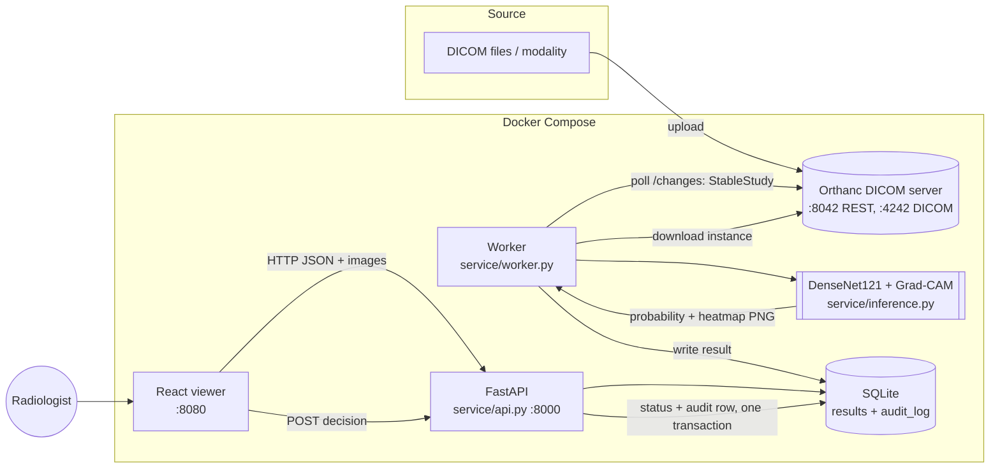
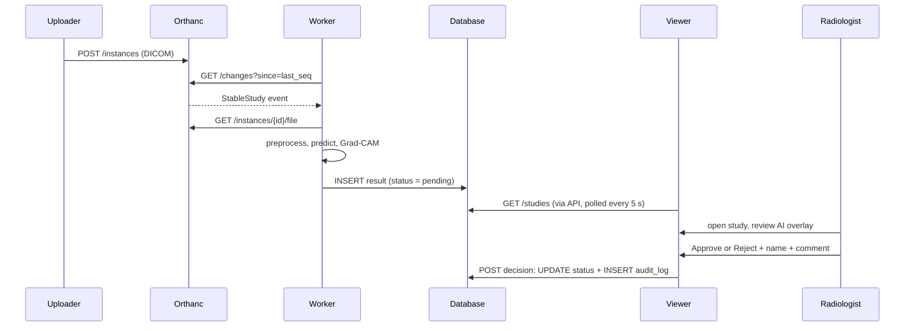

# Architecture

> FOR EDUCATION ONLY. NOT FOR CLINICAL USE.

## System overview

## Sequence for one scan

## Components
| Component | Folder | Role |
|---|---|---|
| ML code | `ml/` | DICOM reading, preprocessing, dataset, training, Grad-CAM |
| Notebooks | `notebooks/` | Colab runs: data download, preprocessing and DVC, training, Grad-CAM |
| Worker | `service/worker.py` | Watches Orthanc, runs inference, stores results |
| Inference | `service/inference.py` | Loads weights, same preprocessing as training |
| API | `service/api.py` | Studies, images, decisions, audit log |
| Database | `service/db.py` | SQLite: `results`, `audit_log`, `state` |
| Viewer | `viewer/` | React UI: worklist, overlay, confidence, approve/reject, audit history |

## Design decisions
- **`StableStudy` trigger.** Orthanc emits it only after a study stops receiving images, so we never analyze half-uploaded studies.
- **`last_seq` in the database.** The worker remembers its position in Orthanc's change feed, so restarts do not reprocess old studies.
- **Decision and audit row in one transaction.** A decision cannot exist without its audit record.
- **Append-only audit.** The API exposes no update or delete for audit rows.
- **Weights outside the image.** `best.pt` is mounted as a volume, so images stay small and weights stay out of git.
- **Training-time preprocessing is reused at inference.** A mismatch here silently degrades accuracy, and a unit test covers the key steps.
